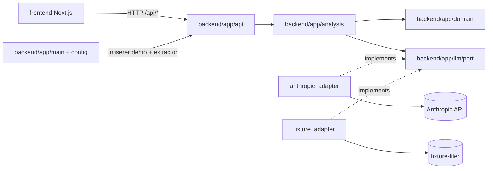
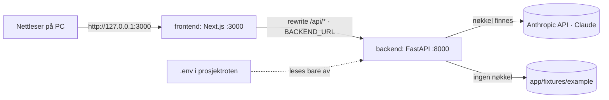
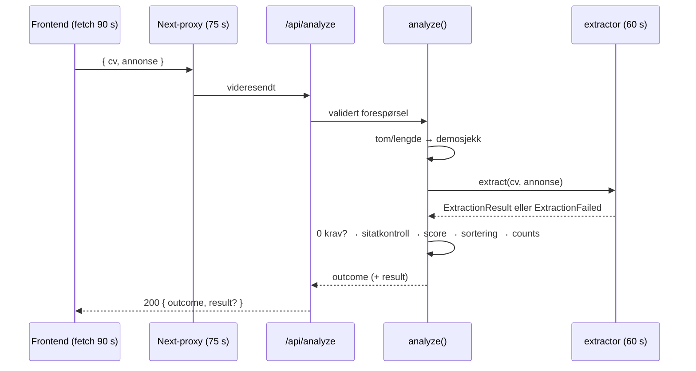

# Architecture Spine — CV & Jobb applikasjonsassistent

## Design Paradigm

**Hexagonal (ports and adapters) i backend, og en tynn presentasjonsklient i frontend.** All forretningslogikk ligger i en ren domenekjerne i backenden. Kjernen snakker med språkmodellen gjennom én port, med to adaptere bak: Anthropic og fixture. Frontenden viser bare det backenden har bestemt.

| Lag | Katalog | Innhold |
| --- | --- | --- |
| Domene | `backend/app/domain/` | Kravmodell, `normalize()`, sitatkontroll, score, sortering, `counts`. Ingen I/O. |
| Applikasjon | `backend/app/analysis/` | `analyze()` kjører pipelinen (AD-4) og velger utfall. |
| Port | `backend/app/llm/port.py` | `RequirementExtractor`, `ExtractionResult`, `ExtractionFailed`, `parse_extraction()`. |
| Adaptere | `backend/app/llm/anthropic_adapter.py`, `backend/app/llm/fixture_adapter.py` | Claude via Anthropic-SDK, og lagrede modellsvar fra fil. |
| HTTP og oppsett | `backend/app/api/`, `backend/app/config.py`, `backend/app/main.py` | FastAPI-ruter, kontrakten (`schemas.py`), settings, kobling av modus og adapter. |
| Presentasjon | `frontend/` | Én Next.js-rute, komponenter, `lib/storage.ts`, `lib/api/`, norske meldinger. |



Avhengigheter går bare i pilenes retning. `domain` importerer ingenting fra andre lag. Ingen modul utenfor `llm/` importerer `anthropic`. Reglene håndheves med `import-linter`-kontrakter i `pyproject.toml`, som kjøres som en test.

## Invariants & Rules

### AD-1 — Backend bestemmer alt, frontend viser [ADOPTED]

- **Binds:** FR-4–FR-12, FR-17, `frontend/`, `backend/`
- **Prevents:** at score, avrunding, sortering, telling, 90 %-regelen eller statuslogikk implementeres to steder og gir ulike svar.
- **Rule:** Frontenden regner aldri, teller aldri, summerer aldri, sorterer aldri og vurderer aldri terskler. Det eneste unntaket er inputgrensen i AD-13. Frontenden kan *filtrere* `requirements` på `status` for å vise ett trinn, men beholder rekkefølgen. Alle tall som vises, kommer ferdig fra svaret, og «Godt treff» vises bare når `show_good_match` er `true`.

### AD-2 — Én LLM-port med fast kontrakt og to adaptere [ADOPTED]

- **Binds:** `backend/app/llm/`, FR-5, FR-6, FR-14, FR-16, testing
- **Prevents:** at demomodus eller tester går utenom pipelinen, at valideringen skjer på ulike steder, og at «rått modellsvar» tolkes på flere måter.
- **Rule:**
  - Porten er `extract(cv, annonse) -> ExtractionResult`. Ved feil kaster den `ExtractionFailed(reason)`, der `reason` er en av `timeout`, `api_error`, `stop_reason`, `refusal` eller `invalid`. Adapteren eier oversettelsen. Use caset ser bare `ExtractionResult` eller `ExtractionFailed`.
  - `ExtractionResult` er `{ requirements: [ { text, type: must|should, status: met|partial|missing, quote: str|null, hint: str|null } ] }`. Rekkefølgen er annonsens.
  - Begge adaptere bruker den samme funksjonen `parse_extraction(text) -> ExtractionResult`, som kaster `ExtractionFailed("invalid")` når validering feiler (AD-4 steg 3).
  - En fixture er en konvolutt: `{ "stop_reason": "end_turn", "text": "<rå JSON-tekst fra modellen>" }`. Fixture-adapteren får filstien i konstruktøren og leser bare den fila.
  - Resultatet fra begge adapterne går gjennom hele pipelinen (AD-4), også sitatkontroll og score. Ingen fixture inneholder ferdige resultater.

### AD-3 — Demomodus og eksempeldata [ADOPTED]

- **Binds:** FR-15, FR-16, FR-17, `backend/app/config.py`, `backend/app/main.py`
- **Prevents:** at frontend og backend er uenige om modus, at modusen sjekkes med ulik regel på flere steder, og at «Bruk eksempel» feiler på grunn av linjeskift.
- **Rule:**
  - Backenden er i demomodus når `ANTHROPIC_API_KEY.strip()` er tom ved oppstart. Modusen logges ved oppstart (uten nøkkelen).
  - `demo: bool` og `extractor` injiseres i `analyze()` som to separate avhengigheter. Bare app-fabrikken i `main.py` kobler dem: demo betyr `demo=True` + `FixtureExtractor("app/fixtures/example/response.json")`, og ekte betyr `demo=False` + `AnthropicExtractor`.
  - `GET /api/status` er eneste kilde til modus for frontenden. Frontenden henter den i nettleseren ved hver sidelasting, aldri ved bygg.
  - Eksempeldataene ligger i `backend/app/fixtures/example/` (`cv.txt`, `annonse.txt`, `response.json`) og leveres via `GET /api/example`. `.gitattributes` setter `backend/app/fixtures/** text eol=lf`, og filene leses som UTF-8 uten BOM.
  - Demosjekken (AD-4 steg 2) sammenligner etter at `\r\n` er gjort om til `\n` i begge strenger, og ellers tegn for tegn. Normaliseringen gjelder bare her.
  - I demomodus er alle resultater eksempelresultater, så frontenden merker resultatet «Eksempeldata» når `demo` er `true`. Feltmerket «Eksempeldata» vises når feltet er likt eksempelteksten.

### AD-4 — Analysepipelinen har fast rekkefølge [ADOPTED]

- **Binds:** FR-1, FR-5, FR-6, FR-7, FR-8, FR-9, FR-10, FR-11, FR-12, FR-14, FR-17, `backend/app/analysis/`, `backend/app/domain/`
- **Prevents:** at sitatkontroll og score kjøres i ulik rekkefølge, at tomme sitater tolkes som både feil og nedgradering, og at avrunding eller terskler tolkes forskjellig.
- **Rule:** `analyze` kjører nøyaktig disse stegene, og stopper ved første utfall:
  1. Et felt der `s.strip() == ""` → `empty_input`. Et felt med mer enn `MAX_CHARS` kodepunkter (AD-13), talt på rå tekst → `text_too_long`.
  2. `demo` er `true`, og teksten er ikke eksempeldataene (AD-3) → `demo_requires_key`.
  3. `extractor.extract()`. `ExtractionFailed` → `analysis_failed`. Det vises aldri et delvis resultat. `parse_extraction` godtar bare svar der `met`/`partial` har `quote.strip() != ""`, og `partial`/`missing` har `hint.strip() != ""`.
  4. 0 krav → `no_requirements`.
  5. Sitatkontroll med `normalize(s) = re.sub(r"\s+", " ", unicodedata.normalize("NFC", s)).strip()`. Et sitat godtas når `normalize(quote)` er en delstreng av `normalize(cv)`. Store og små bokstaver og tegnsetting må stemme. Det finnes ingen minstelengde.
  6. Score i halvpoeng som heltall (må 4/2/0, bør 2/1/0): `match_score = (200·a2 + m2) // (2·m2)`, der `a2` er oppnådde og `m2` maks halvpoeng. Det brukes ingen flyttall og ikke Pythons `round()`.
  7. `potential_score` regnes på samme måte med `partial` som `met`. Den er `null` når det ikke finnes `partial`-krav, eller når den blir lik `match_score`.
  8. Stabil sortering (`sorted` med nøkkelen `(status_rang, type_rang)`): `met` → `partial` → `missing`, og `must` før `should`. Ellers beholdes modellens rekkefølge, som skal følge annonsen.
  9. `show_good_match = match_score >= 90`. `counts` regnes til slutt.
- **Invarianter etter steg 5** (sjekkes med en `model_validator` på `Requirement` i svaret):

| Status | `quote` | `hint` | `downgraded` | `rejected_quote` |
| --- | --- | --- | --- | --- |
| `met` | tekst | `null` | `false` | `null` |
| `partial` | tekst | tekst | `false` | `null` |
| `missing` (fra modellen) | `null` | tekst | `false` | `null` |
| `missing` (nedgradert) | `null` | `null` | `true` | det avviste sitatet |

### AD-5 — Backenden eier kontrakten, og frontendtypene genereres [ADOPTED]

- **Binds:** `backend/app/api/`, `frontend/lib/api/`
- **Prevents:** at datamodellen skrives for hånd i TypeScript, eller genereres fra ulike kilder og glir fra Pydantic-modellen.
- **Rule:** Pydantic-modellene i `backend/app/api/schemas.py` er den eneste definisjonen. `backend/scripts/export_openapi.py` skriver `app.openapi()` til `frontend/lib/api/openapi.json` uten at serveren kjører. `npm run gen:api` genererer `frontend/lib/api/types.gen.ts` med openapi-typescript. Ingen av de to filene redigeres for hånd. En pytest-test feiler hvis den committede `openapi.json` ikke stemmer med `app.openapi()`.

### AD-6 — API-flaten og utfallene er faste [ADOPTED]

- **Binds:** FR-1, FR-11, FR-12, FR-14, FR-15, FR-16, FR-17
- **Prevents:** at feil og meldinger sendes på ulike måter (HTTP-statuskoder, fritekst, unntak), at typer genereres ulikt, og at tekst finnes to steder.
- **Rule:**
  - `GET /api/status` → `{ "demo": bool, "max_chars": int }`
  - `GET /api/example` → `{ "cv": str, "annonse": str }` i demomodus, ellers `404`
  - `POST /api/analyze` med `{ "cv": str, "annonse": str }` → alltid `200` med en diskriminert union på `outcome`: `{ "outcome": "result", "result": AnalysisResult }`, eller `{ "outcome": "empty_input" | "text_too_long" | "demo_requires_key" | "no_requirements" | "analysis_failed" }`. Alle felt er påkrevd, og `null` sendes alltid eksplisitt. `422` betyr bare feil form (manglende felt, ikke streng), og svaret tar aldri med `input`.
  - Backenden sender ingen egne brukertekster. Bare kravtekster og hint kommer fra modellen. Frontenden eier alle norske meldinger, også «Fant ikke belegg i CV-en for dette kravet», som vises for `downgraded: true` uansett analysespråk.
  - Frontenden viser meldingen for `analysis_failed` ved alt som ikke er et gyldig `200`-svar: `422`, `5xx`, nettverksfeil og tidsavbrudd.

### AD-7 — CV- og annonsetekst lagres eller logges aldri [ADOPTED]

- **Binds:** FR-2, FR-3, PRD §5 Personvern, alle enheter
- **Prevents:** at teksten havner i en database, fil, logg, konsoll eller cache.
- **Rule:**
  - Det finnes ingen database. Bare `frontend/lib/storage.ts` leser og skriver `sessionStorage`-nøkkelen `cvjobb:fields`, med formen `{ "v": 1, "cv": str, "annonse": str }`. At en gjenåpnet eller duplisert fane kan få feltene tilbake, er et akseptert avvik fra FR-2.
  - Backenden holder teksten bare i minnet under forespørselen. Loggen går til stdout som JSON med `outcome`, `duration_ms`, `model` (`"fixture"` i demo) og `tokens {input, output}`, aldri `cv`, `annonse`, sitater, hint eller modellsvar.
  - Loggerne for `anthropic` og `httpx` står på WARNING. Unntak logges med `type(e).__name__`, aldri `str(e)`. En egen `RequestValidationError`-handler fjerner `input` fra `422`.
  - Frontenden logger aldri forespørsels- eller svarkropper.

### AD-8 — Claude kalles bare via den offisielle SDK-en med strukturert output [ADOPTED]

- **Binds:** `backend/app/llm/anthropic_adapter.py`, kostnadstaket i PRD §5
- **Prevents:** fritekstparsing, egen JSON-tolking, ukontrollert tid og ukontrollert kostnad.
- **Rule:**
  - Klienten er `Anthropic(timeout=60.0, max_retries=0)`.
  - Kallet er `client.beta.messages.parse(model=settings.anthropic_model, max_tokens=6000, output_format=ExtractionResult, output_config={"effort": "medium"}, betas=["server-side-fallback-2026-07-01"], fallbacks="default", …)`. Standardmodellen er `claude-opus-5-5` (`ANTHROPIC_MODEL`).
  - `stop_reason` ≠ `end_turn` → `ExtractionFailed("stop_reason")`. `refusal` → `ExtractionFailed("refusal")`. Teksten valideres med `parse_extraction` (AD-2).
  - Systemprompten krever ordrette sitater tegn for tegn, korte hint, ingen ny erfaring, ingen omskrevne setninger, krav i annonsens rekkefølge, og språkregelen i PRD §5. Modellen gir aldri tall eller score.
  - `max_tokens` 6 000 og effort `medium` er startverdier som justeres etter testsettet. Verste tilfelle (2 × 15 000 tegn ≈ 12k tokens inn og 6 000 ut) koster ≈ $0,17, altså ≈ 1,8 kr.

### AD-9 — Tester går aldri mot nettet [ADOPTED]

- **Binds:** PRD §5 Testing, SM-1, SM-4, `backend/tests/`, `frontend/`
- **Prevents:** tester som koster penger, krever nøkkel, leser en ekte nøkkel fra `.env` eller gir ulike svar fra gang til gang.
- **Rule:**
  - pytest kjører med `ANTHROPIC_API_KEY=""` satt i miljøet. En `autouse`-fixture feiler testen hvis `AnthropicExtractor` opprettes med ekte klient.
  - Use case- og API-tester bygger `analyze` med `demo=False` og `FixtureExtractor(<sti>)` (eller `app.dependency_overrides`).
  - Testsvarene ligger i `backend/tests/fixtures/`, både gyldige og ugyldige (manglende felt, ukjent status, tomt sitat, tomt hint, oppdiktet sitat, `stop_reason: max_tokens`). Anthropic-adapteren testes med en mocket SDK-klient for tidsavbrudd, `stop_reason` og `refusal`.
  - Eksempelsvaret i `app/fixtures/example/response.json` har minst ett krav av hver status og ett oppdiktet sitat, slik at demoen viser en nedgradering. En test sjekker dette.
  - Domenet testes med faste kravlister, også alle scorekombinasjoner opp til 20 krav mot `Fraction`. Grensetester for `MAX_CHARS` (14 999, 15 000, 15 001 og tekst med emoji) finnes i både pytest og Vitest.
  - Playwright kjører hele flyten i demomodus, også «Bruk eksempel» → «Analyser» → resultat, med `@axe-core/playwright` på input, resultat og meldinger.
  - Testsettet (SM-2, SM-3, SM-C1) kjøres manuelt med `backend/scripts/run_testset.py` mot ekte Claude. Fasiten ligger i `backend/testset/`, og resultatene (statuser, antall, tokens, kostnad, aldri CV-tekst) skrives til `.docs/testset-results/<dato>.md`.

### AD-10 — Nøkkelen finnes bare i backenden [ADOPTED]

- **Binds:** `.env`, `backend/app/config.py`, `frontend/`, `docker-compose.yml`
- **Prevents:** at API-nøkkelen havner i nettleseren, i frontend-containeren eller i git, eller at backenden ikke finner `.env`.
- **Rule:** `.env` ligger i prosjektroten og leses bare av backenden (pydantic-settings), med absolutt sti beregnet fra `config.py` (`Path(__file__).resolve().parents[2] / ".env"`). `.env` står i `.gitignore`, og `.env.example` dokumenterer `ANTHROPIC_API_KEY` og `ANTHROPIC_MODEL`. Frontenden har ingen hemmeligheter. Next.js sender `/api/*` videre til `BACKEND_URL`, som er `http://localhost:8000` lokalt og `http://backend:8000` i Compose, og som leses når serveren starter.

### AD-11 — Docker Compose og vanlig kjøring gir samme app [ADOPTED]

- **Binds:** PRD §5 Kjørbarhet, UJ-2, README
- **Prevents:** at sensor ser en annen app med Docker enn utviklerne ser lokalt, eller at oppsettet bare virker på én maskin.
- **Rule:**
  - `docker compose up` starter `backend` (`fastapi run --host 0.0.0.0 --port 8000`, `env_file: .env`) og `frontend` (`next dev -p 3000`, `environment: BACKEND_URL=http://backend:8000`, uten `env_file`). Portene bindes til `127.0.0.1`, og `frontend` venter på en healthcheck mot `/api/status`.
  - Uten Docker brukes `uv run fastapi dev` i `backend/` og `npm run dev` i `frontend/`, med de samme portene.
  - Begge måtene starter i demomodus når nøkkelen mangler.
  - Installasjonen er reproduserbar: `uv.lock` og `package-lock.json` committes, og installasjon skjer med `uv sync --frozen` og `npm ci`.

### AD-12 — UI bygges på shadcn/ui, tematisert av DESIGN.md [ADOPTED]

- **Binds:** `frontend/`, DESIGN.md, EXPERIENCE.md
- **Prevents:** at komponentbibliotekets standardutseende overstyrer designet, eller at tokens defineres flere steder.
- **Rule:** DESIGN.md-tokens defineres én gang i `frontend/app/globals.css` (Tailwind v4 `@theme`). shadcn sine CSS-variabler (`--background`, `--primary` …) peker bare på disse tokenene og har aldri egne verdier. Ved konflikt gjelder DESIGN.md og EXPERIENCE.md foran shadcn-standarder og mockups.

### AD-13 — Inputgrensen [ADOPTED]

- **Binds:** FR-1, `frontend/` (felt og teller), `backend/app/analysis/`
- **Prevents:** at frontend og backend teller tegn ulikt, at grensen hardkodes to steder, og at innlimt tekst kuttes stille.
- **Rule:** Ett tegn er ett Unicode-kodepunkt i strengen slik den sendes. Backenden teller med `len(s)`, frontenden med `Array.from(s).length`. Det normaliseres ikke før tellingen. `MAX_CHARS = 15000` finnes bare i backenden, og frontenden får verdien fra `/api/status` (`max_chars`). Frontenden speiler grensen og tomhetssjekken for å vise teller, «Teksten er for lang» og deaktivert «Analyser», men backenden er fasit. `<textarea>` har ikke `maxLength`.

### AD-14 — Tidsbudsjettet er strengt økende gjennom kjeden [ADOPTED]

- **Binds:** FR-13, FR-14, `anthropic_adapter`, `frontend/next.config.ts`, frontend-klienten
- **Prevents:** at et ledd lenger ute kutter en analyse som backenden fortsatt behandler, og at retries gjør tiden og kostnaden større enn taket.
- **Rule:** SDK-kallet har 60 s og ingen retries (AD-8). Next-proxyen har `experimental.proxyTimeout: 75000`, satt eksplisitt i `next.config.ts`. Frontendens `fetch` har `AbortSignal.timeout(90_000)`. Alle brudd ender som meldingen for `analysis_failed` (AD-6). Kostnadstaket gjelder per analyse, inkludert fallback.

### AD-15 — Frontenden har én rute med en tilstandsmaskin [ADOPTED]

- **Binds:** FR-2, FR-9, FR-10, FR-13, EXPERIENCE (IA), `frontend/app/`
- **Prevents:** at input og resultat bygges som egne ruter som mister tilstanden, eller at flere komponenter eier navigasjonen.
- **Rule:** Appen er én rute (`/`) med tilstandene `input → analyzing → outcome`. Aktivt resultattrinn ligger i URL-hashen (`#oversikt`, `#bra`, `#tydeligere`, `#mangler`, `#alt`). Resultatet holdes bare i React-tilstand. Oppdateres siden, kommer brukeren tilbake til input med feltene fra `sessionStorage`.

## Consistency Conventions

| Concern | Convention |
| --- | --- |
| Språk i kode | Identifikatorer, filnavn og API-felt på engelsk, og all brukertekst på norsk i frontenden. Ordlisten i PRD §3: krav = `requirement`, må-/bør-krav = `must`/`should`, truffet/delvis truffet/mangler = `met`/`partial`/`missing`, sitat = `quote`, forbedringshint = `hint`, match-score = `match_score`, potensiell score = `potential_score`. |
| JSON | `snake_case`. Genererte TS-typer beholder `snake_case`. Score er heltall 0–100. Poeng er tall med bare ,0 eller ,5 (aldri `Decimal`). Utfall og statuser er små bokstaver med understrek. |
| `AnalysisResult` | `match_score`, `potential_score` (eller `null`), `show_good_match`, `points_achieved`, `points_max`, `requirements[]` og `counts`. Hvert krav har `text`, `type`, `status`, `quote`, `hint`, `downgraded`, `rejected_quote`, `points` og `points_max` (AD-4-tabellen). `counts` = `{ met: {must, should, total}, partial: {…}, missing: {…}, downgraded }`, og regnes etter sitatkontrollen. |
| Feil | Utfall som data (AD-6). Uventede unntak i backenden blir `analysis_failed` og logges uten innhold (AD-7). |
| Konfigurasjon | Bare miljøvariabler via `.env` og pydantic-settings, og `BACKEND_URL` for frontenden. Ingen feature flags. |
| Frontendtilstand | `lib/storage.ts` for feltene (AD-7), React-tilstand for resultatet, URL-hash for aktivt trinn (AD-15). Ingen global state-butikk. |
| Versjoner og installasjon | `.python-version` = 3.14 og `requires-python = ">=3.14,<3.15"`. `package.json#engines.node` = `>=26`. Låsefiler committes. Dockerfilene bruker `python:3.14-slim` og `node:26-slim`. |
| Kodestil | Backend: ruff (lint og format) og import-linter. Frontend: ESLint og Prettier. Alt kjøres før commit. |

## Stack

| Name | Version |
| --- | --- |
| Python | 3.14 |
| uv | >=0.12 |
| FastAPI (`fastapi[standard]`, med fastapi-cli) | 0.163.1 |
| Pydantic | 2.14.3 |
| pydantic-settings | 2.16.3 |
| anthropic (Python SDK) | 2.9.0 |
| Uvicorn | 0.54.0 |
| pytest | 9.2.0 |
| httpx (bare TestClient) | 0.28.1 |
| ruff | 0.17.5 |
| import-linter | 2.16 |
| Node.js | 26 LTS |
| Next.js | 16.4.6 |
| React | 19.3.1 |
| TypeScript | 5.9.3 |
| Tailwind CSS | 4.3.5 |
| shadcn (CLI) | 4.23.0 |
| openapi-typescript | 7.13.0 |
| Vitest | 5.1.0 |
| Playwright (@playwright/test) | 1.65.1 |
| @axe-core/playwright | 4.14.0 |
| ESLint | 10.15.0 |
| Prettier | 3.10.1 |
| Claude-modell (standard) | claude-opus-5-5 |
| Docker Compose (plugin, `docker compose`) | >=2.20 |

## Structural Seed

### System og kjøring



Det finnes bare ett miljø: lokal kjøring, enten med Docker Compose eller med `uv` og `npm`. Det er ingen produksjon, ingen sky, ingen database og ingen CI i v1.

### Analyseflyt



### Kildetre

```text
backend/
  app/
    api/            # FastAPI-ruter, schemas.py (kontrakten), 422-handler
    analysis/       # analyze()
    domain/         # normalize, sitatkontroll, score, sortering, counts
    llm/            # port.py, anthropic_adapter.py, fixture_adapter.py, prompt.py
    fixtures/example/  # cv.txt, annonse.txt, response.json (demo)
    config.py       # pydantic-settings, absolutt .env-sti
    main.py         # app-fabrikk: kobler demo + extractor
  scripts/          # export_openapi.py, run_testset.py
  testset/          # 5 annonser, 3 fiktive CV-er, fasit
  tests/            # pytest + tests/fixtures/
  pyproject.toml  uv.lock  .python-version
frontend/
  app/              # én rute (/), globals.css med DESIGN.md-tokens
  components/       # shadcn-baserte komponenter
  lib/              # storage.ts, messages.ts, api/ (openapi.json, types.gen.ts, klient)
  e2e/              # Playwright (demomodus, axe)
  next.config.ts  package.json  package-lock.json
docker-compose.yml  .env.example  .gitattributes  README.md
```

## Capability → Architecture Map

| Capability / Area | Lives in | Governed by |
| --- | --- | --- |
| FR-1 Innliming, maks 15 000 tegn | `frontend/` (felt, teller) + `analysis/` steg 1 | AD-4, AD-13 |
| FR-2 Teksten beholdes i fanen | `frontend/lib/storage.ts` | AD-7, AD-15 |
| FR-3 Personvernvarsel | `frontend/` | AD-6, AD-7 |
| FR-4 Kravuttrekk | `llm/prompt.py` + `port.py` | AD-2, AD-8 |
| FR-5 Status med sitat | `llm/` + `domain/` | AD-2, AD-4 |
| FR-6 Forbedringshint | `llm/` (prompt, validering) | AD-4, AD-8 |
| FR-7 Match-score | `domain/` | AD-1, AD-4 |
| FR-8 Potensiell score | `domain/` | AD-4 |
| FR-9 Rekkefølge og innhold | `domain/` (sortering) + `frontend/` (filtrering per trinn) | AD-1, AD-4, AD-15 |
| FR-10 Godt treff | `domain/` (`show_good_match`) + `frontend/` | AD-1, AD-4 |
| FR-11 Sitatkontroll | `domain/` + `frontend/lib/messages.ts` (hint for nedgradert) | AD-4, AD-6 |
| FR-12 Ingen krav funnet | `analysis/` | AD-4, AD-6 |
| FR-13 Venting | `frontend/` | AD-14, AD-15 |
| FR-14 Feil i analysen | `llm/` + `analysis/` + `frontend/` | AD-2, AD-4, AD-6, AD-14 |
| FR-15 Demobanner | `config.py` + `/api/status` + `frontend/` | AD-3 |
| FR-16 Bruk eksempel | `fixtures/example/` + `/api/example` + `FixtureExtractor` | AD-2, AD-3 |
| FR-17 Egen tekst i demomodus | `analysis/` steg 2 | AD-3, AD-4 |
| SM-1, SM-4 Automatisk testing | `backend/tests/` | AD-9 |
| SM-2, SM-3, SM-C1 Testsett | `backend/scripts/run_testset.py` + `backend/testset/` | AD-9 |
| SM-5 Brukertest | Manuell protokoll i `.docs/` | — |
| UJ-2 Sensor uten nøkkel | Docker Compose + demomodus | AD-3, AD-11 |
| WCAG 2.2 AA | `frontend/e2e/` (axe) | AD-9 |

## Deferred

| Utsatt | Hvorfor det kan vente |
| --- | --- |
| Publisering på nett, kostnadstak på kontonivå og misbruksvern | v2 i PRD §7.2. Appen kjøres bare lokalt i v1. |
| PDF-opplasting og annonse som lenke eller bilde | v2 i PRD §7.2. Endrer bare input, ikke kjernen. |
| Endelig modell (Opus 5.5 eller Sonnet 5.5), effort og `max_tokens` | Avgjøres etter testsettet (AD-9). Verdiene er innstillinger i AD-8, så valget flytter ingen grenser. |
| Selve prompten og innholdet i fixturene | Skrives i stories innenfor rammene i AD-2, AD-8 og AD-9. |
| Bruddpunkt under 1280 px | Åpent punkt i UX. Påvirker bare frontendlayout. |
| CI-pipeline | Ikke krav i v1. Testene kjøres lokalt (`uv run pytest`, `npm test`, `npx playwright test`). |
| Målet for README-lenken i demobanneret | Avgjøres når repoet har sin endelige URL. Lenken står som én konstant i `frontend/lib/messages.ts`. |
